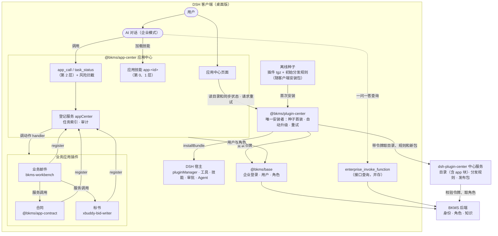

# BKMS 应用中心技术方案

Oct 24, 2026 · @sub.maureen

> 修订（2026-10-24）：对照 xbuddy（DSH）、bkms-workbench、xbuddy-bid-writer、bkms-plugin-center 源码和桌面 Profile 调整。主要变化：第 0、1 层改用 DSH 技能机制，去掉 `app_guide` 和自拼 `systemPrompt.section`；风险拦截改用 `tools/pre-execute` 的 `ask`；身份和角色复用 `@bkms/base`；版本兼容交给 DSH 的 peer 检查；回滚改为发修复版；补充工具可见范围、数据位置、依赖打包和首批应用的实际改动量。与现有代码的冲突和待验证项见文末两节。

> 修订（2026-10-24，分发方式）：所有插件的安装和升级只由 plugin-center 执行。客户端预装 plugin-center 并附带离线种子（插件 tgz + 初始分发规则），首次安装从种子完成；之后按中心分发规则自动升级和新增，不做按需下载。应用中心和 AI 对话都没有安装能力：去掉 `app_call` 的 install 动作、安装风险级别、“（需安装）”占位技能和页面安装接口；应用中心只读取 plugin-center 的目录和同步状态，失败时请求重试。预装机制分析见《[XBuddy 预装插件机制分析](XBuddy%20预装插件机制分析.md)》。

## 结论与总体架构

新建一个独立插件 `@bkms/app-center`（应用中心），负责面向用户的应用目录、应用登记和 AI 对话集成。所有插件（含应用中心自己）的安装和升级只由现有的 `@bkms/plugin-center` 执行。

- **不合并的原因**：plugin-center 是分发底座，管所有插件、要稳定，升级自己总要重启；应用中心跟着业务频繁改动，而且会被 AI 调用。分开后，安装能力只留在 plugin-center 内部，应用中心和 AI 都碰不到。DSH 自带的 `plugin_manager` 工具在桌面版主对话中已禁用，需保持禁用。
- **分发**：客户端预装 plugin-center 并附带离线种子；plugin-center 首次启动从种子安装应用中心、业务应用和其他 BKMS 插件，之后按中心分发规则自动升级和新增。
- **对话侧**：每个应用登记为一个 DSH 技能（第 0、1 层），只注册 2 个通用工具 `app_call`、`task_status`（第 2 层）。应用再多也不增加常驻工具。
- **应用侧**：合同、标书、业务邮件各自是 DSH 插件，有自己的页面和后台任务，运行时向应用中心登记动作。
- **身份**：用户和角色来自已预装的 `@bkms/base`（企业登录），不另建身份体系。
- **改动量**：plugin-center 加只读服务（目录、状态、重试）和离线种子；XBuddy 预装清单只留 plugin-center，预装逻辑不再卸载移出清单的包；中心服务目录增加可选的 `app` 块，并用 BKMS 令牌鉴权、按角色过滤；业务邮件和标书各需补若干服务方法（见“首批应用”）。

### 总体架构



不支持 Mermaid 的查看器可参考下面的分层示意：

```
用户 ──► 应用中心页面 ─────────────┐
用户 ──► AI 对话（企业模式）        │
          │ 加载技能 app-<id>       │ 读目录和同步状态、请求重试（不安装）
          │ 调 app_call / task_status
          ▼                         ▼
   @bkms/app-center ──只读──► @bkms/plugin-center ──installBundle──► DSH 宿主
   （登记 · 技能 · 拦截 · 任务索引 · 审计）      │  ▲
          ▲ register        调 handler          │  └─ 离线种子（随客户端：tgz + 初始规则）
          │                     │               │ 带 BKMS 令牌取目录、规则和新包
   业务应用：业务邮件 / 合同 / 标书               ▼
   （由 plugin-center 安装和升级）        dsh-plugin-center 中心服务
                                                   │ 校验令牌、取角色
                                                   ▼
   @bkms/base（企业登录、用户、角色）──────────► BKMS 后端
   enterprise_invoke_function（接口查询，与应用中心并存）──► BKMS 后端
```

| 组件 | 在架构中的位置 |
| --- | --- |
| 应用中心 | 用户和 AI 的入口；业务应用向它登记；只读取 plugin-center 的目录和同步状态，不安装 |
| plugin-center | 唯一的安装者：首次从离线种子安装，之后按分发规则自动升级和新增，失败可重试 |
| 离线种子 | 随客户端安装包提供的插件 tgz 和初始分发规则，保证断网首次启动也能装好 |
| 中心服务 | 按用户角色下发目录、分发规则和发布包 |
| `@bkms/base` | 身份来源：客户端组件用它取用户和角色，中心服务凭它的令牌向 BKMS 后端验证 |
| 业务应用 | 运行时登记动作；能力以服务形式提供，应用之间直接调用 |
| `enterprise_invoke_function` | 现有的接口查询通道，与应用中心并存、分工不同 |

AI 和用户都只和应用中心打交道；业务应用向它登记动作。所有插件由 plugin-center 自动装好和升级，应用中心只展示同步状态。

## 组件与职责

| 组件 | 新建 / 改造 | 做什么 | 不做什么 |
| --- | --- | --- | --- |
| `@bkms/app-center` 应用中心插件 | 新建 | 应用登记服务；应用技能生成；2 个对话工具；风险拦截；任务索引；应用中心页面（含同步状态）；结果卡片渲染；审计记录 | 下载、校验、安装、升级任何插件；分发规则 |
| `@bkms/plugin-center` 插件中心 | 改造（0.3.0） | 唯一安装者：离线种子首装、下载、SHA256 校验、串行安装、自动升级、失败重试、刷新 / 重启提示；只读服务 `bkmsPluginCenter`（目录、状态、重试）；请求目录时带 BKMS 令牌 | 业务分类、AI 相关功能；对外提供安装接口 |
| XBuddy 桌面端 | 小改 | 预装清单只保留 plugin-center；预装逻辑不再卸载移出清单的包（交给 plugin-center 接管）；打包时把离线种子放进安装包 | 安装业务插件 |
| `dsh-plugin-center` 中心服务 | 改造（0.6.0） | 发布包和目录；目录增加 `app` 块；校验 BKMS 令牌并按角色返回目录和分发规则 | 客户端运行时逻辑 |
| `@bkms/base` | 不改 | 企业登录；`bkmsApi.auth.user`（tenantCode、userId）、`getAccessToken()`；客户端 `bkmsAuthUi.getRoleIds()` | — |
| 业务应用插件（业务邮件 / 合同 / 标书） | 邮件、标书已有，合同新建 | 自己的页面、服务、后台任务和技能；启动时向应用中心登记清单 | 直接注册对话工具（常驻白名单除外）；自己对外发送 |
| DSH 宿主 | 不改 | 插件热插拔、`pluginManager`、工具、技能、Agent、审批、页面 | — |

依赖方向：业务应用 → app-center ⇢ plugin-center（只读）→ 中心服务；app-center 和中心服务都依赖 `@bkms/base` 提供身份。业务应用对 app-center 是**可选依赖**：没装应用中心时，应用页面照常可用，只是不进对话。app-center 对 plugin-center 也是可选依赖：缺少时只显示已登记的应用。

与企业知识调用的分工：`@bkms/knowledge-execute` 的 `enterprise_invoke_function` 由知识检索命中、后端鉴权后签发绑定会话和轮次的临时引用，适合一问一答的接口查询（目前是智能问数），本期保持不动；有页面、有任务的应用走应用中心。应用数量明显增多后，评估把应用登记为接口知识、由检索选择第 0 层。

## 应用中心插件设计

### 登记服务 `appCenter`

业务应用用 `ctx.inject(['appCenter'], …)` 拿到服务并登记自己；插件停用或卸载时，登记随 `ctx.effect` 自动撤销。

```ts
interface AppCenter {
  version: 1
  register(manifest: AppManifest, handlers: Record<string, ActionHandler>): Disposable
  list(): AppSummary[]                 // 已登记应用
  call(appId, action, args, exec): Promise<ActionResult>
  tasks: { report(task: TaskRecord): void; get(id): TaskRecord }
}

type ActionHandler = (args: unknown, exec: ExecContext) => Promise<ActionResult>
interface ExecContext {
  sessionId: string                    // exec.agent.session.header.id
  subagent: boolean                    // header.origin === 'subagent' 或有调用深度
  user: { tenantId: string; userId: string }   // ctx.bkmsApi.auth.user
  signal: AbortSignal
}
interface ActionResult {
  summary: string          // 一两句结论
  items?: { title: string; link?: AppLink }[]
  task?: { id: string; etaMinutes?: number }
  external?: string        // 外部内容（来信、附件文字），单独标注
  draft?: boolean          // 为真时结果必须写明“尚未发送”
}
```

### 第 0、1 层：应用技能

不再使用 `systemPrompt.section` 和 `app_guide` 工具，改为每个应用注册一个内存技能（`ctx.skills.register`），由 DSH 的 `skill` 工具负责目录和按需加载：

| 技能字段 | 来源 |
| --- | --- |
| name | `app-<id>`，如 `app-contract` |
| description | 清单 `summary`，不超过 40 字；第 0 层目录就是这一行 |
| content | 由清单生成的第 1 层用法：动作、参数（含示例）、`askFirst`、`notFor`、外部内容规则、“先用 `app_call` 执行” |
| invocation | `modelInvocable: true, userInvocable: true` |

- 只为已登记（已安装）的应用注册技能；plugin-center 还没装好的应用不进技能目录，装好登记后自动出现。
- 登记、升级、卸载时更新技能；DSH 会在进行中的对话里追加新的目录，旧名称自动停用。
- 目录按固定顺序排列，不按使用次数排序，避免打断提示缓存。
- 用户在输入框输入 `/app-<id>` 会直接带上该应用用法，“在对话中使用”复用这一点。
- 选择技能机制的理由：DSH 已经实现“目录常驻、正文按需加载、中途追加目录”，并在目录里要求模型先加载、不能只凭摘要行事；自己再做一套会重复，还会每次改动系统提示。

### 对话工具

| 工具 | 参数 | 行为 |
| --- | --- | --- |
| `app_call` | `app`, `action`, `args` | 按清单校验参数后调用应用的 handler；校验失败返回正确的参数说明和示例。目标应用还没装好时返回 plugin-center 的同步状态（正在安装 / 等待安装 / 需刷新或重启 / 安装失败请到应用中心重试），没有安装动作 |
| `task_status` | `task_id` | 返回任何应用长任务的状态、结论摘要和链接 |

常驻白名单：高频动作（首批只有 `mail.search`）可以由应用中心额外注册成独立工具 `mail_search`，总数不超过 5 个，由应用中心配置控制，应用不能自己加。

**可见范围**：`ctx.tools.register` 注册的全局工具会被所有 Agent 继承，包括子 Agent 和其他插件的后台 Agent（工作台的后台 Agent 用白名单限制，不受影响）。应用中心在 `tools/pre-execute` 中按 `exec.agent.session.header` 判断：

- 顶层对话：完整开放；
- 子 Agent（`origin === 'subagent'` 或有调用深度）：只能执行 `read` 级动作，其他级别拒绝。

### 结果展示

- 工具的 `output.render` 生成给模型看的文字：先结论，再“在应用中打开”的说明；`draft` 为真时加“尚未发送”；`external` 内容加“外部内容”标记。
- `output.presentationMeta` 输出卡片数据（标题、状态、链接）。应用中心的客户端入口注册 `tool.call.toolview`（键为 `app_call`、`task_status`、`mail_search`），渲染可点击卡片，点击跳转到应用页面。

### 风险拦截

`ctx.on('tools/pre-execute')` 只拦 `app_call`，按目标动作的 `risk` 返回决策，弹窗使用宿主自带审批界面（`{ kind: 'ask', displayReason }`）：

| risk | 行为 |
| --- | --- |
| `read` | 直接执行（`next()`） |
| `draft` | 默认直接执行；可在设置中改为 `ask`。发送前必须经过工作台人工审核 |
| `write` | `ask`，文案由清单的 `confirmText` 模板生成 |
| 子 Agent 的非 `read` 调用 | `deny` |

对外发送不设 risk 级别：清单里出现发送类动作时登记直接拒绝。对话发起的草稿必须带“来自对话”标记，工作台据此排除自动发送。

### 页面与接口

- 左侧入口 **应用中心**：沿用 `@bkms/ui-skills` 工具集市的布局、尺寸和 DSH 设计变量（标题与搜索固定、分类标签换行、卡片区独立滚动、三列卡片），标题“企业应用中心 · 管理中心”。
- 卡片：圆形字标图标、名称、分类标签、一句话描述、“N 万人聊过”；整张卡片是唯一的操作入口，没有安装、打开、详情按钮。
- 点击即使用：已安装 → 打开应用页面（`layout.selectPanel(page)`），没有页面的应用新开对话并提示 `/app-<id>`；还没装好的应用，卡片显示 plugin-center 的同步状态：等待安装、安装中（进度）、已安装需刷新 / 重启、安装失败；点击安装中的应用，装好登记后自动打开；点击失败的应用，请 plugin-center 重试。页面本身不安装。
- 状态来源：中心目录里有、但还没登记的应用，按 `bkmsPluginCenter.status()` 的 `progress`、`notices`、`plugins`（失败次数和原因）推出状态。
- 不兼容当前客户端的插件不会被下发（plugin-center 不推送，DSH 也拒绝加载）。
- 后端接口（`/api/bkms-app-center/*`，POST 只接 JSON，沿用 plugin-center 的防跨站做法）：

| 接口 | 用途 |
| --- | --- |
| GET /apps | 已登记应用 + 中心目录中尚未装好的应用及其同步状态 |
| GET /apps/:id | 单个应用信息与生成的技能（供调试；未登记的应用没有技能） |
| POST /apps/:id/retry | 请 plugin-center 重试安装失败的应用 |
| GET /tasks?app=&status= | 任务列表 |
| GET /activity | 对话调用审计记录 |

## 数据格式

应用信息分两处放：中心目录只放**展示和分发**需要的字段（含权限、角色，以服务端为准）；动作和参数由应用**运行时登记**，跟着插件版本走，升级后自动更新。

### 中心目录条目（plugins.json）

在现有字段（`name` / `packageName` / `url` / `description` / `version` / `artifact`）上增加可选的 `app` 块。没有 `app` 的条目是普通插件，不进应用中心。

```json
{
  "name": "合同",
  "packageName": "@bkms/app-contract",
  "url": "https://plugins.company.example/p/app-contract",
  "description": { "zh": "合同风险评审与按模板起草" },
  "version": "1.2.0",
  "artifact": { "url": "…", "sha256": "…", "size": 1048576, "version": "1.2.0", "manifest": {}, "restart": { "mode": "none" } },
  "app": {
    "id": "contract",
    "category": "法务",
    "summary": "合同风险评审、按模板起草",
    "icon": "审",
    "permissions": ["workbench.mail.read", "files.workspace.read"],
    "roles": ["legal", "sales"],
    "minAppCenter": "1.0.0",
    "changelog": "新增按报价起草"
  }
}
```

- `app.id` 与包名分开：已有应用保留原包名（`bkms-workbench`、`xbuddy-bid-writer`），改名在 pnpm 看来是另一个包，会断开数据和升级路径。
- 客户端兼容范围不单设字段，直接取 `artifact.manifest.peerDependencies` 中的 `@deepseek-ai/dsh*`。
- 后续如需按平台分包，`artifact` 扩展为按 `platform-arch` 区分的列表（见冲突 C6）。

### 应用清单（运行时登记）

```ts
interface AppManifest {
  id: string                       // 与目录 app.id 一致
  name: string; category: string
  summary: string                  // 技能描述和卡片共用，≤40 字
  askFirst?: string[]              // 发起前要问用户的问题
  notFor?: string[]                // 不适用的情况及该用谁
  page?: string                    // 应用页面路由
  actions: ActionSpec[]
}
interface ActionSpec {
  name: 'start' | 'list' | 'get' | 'status' | string   // 统一动词优先
  description: string
  whenToUse: string[]; notFor?: string[]
  params: JSONSchema               // 能用枚举就用枚举
  examples: string[]               // 用户原话
  risk: 'read' | 'draft' | 'write'
  long?: boolean                   // 长任务：立即返回 task
  confirmText?: string             // write 级弹窗文案模板
  aliases?: string[]               // 改名后保留的旧名
}
```

生效方式不在清单里重复定义：由发布包的 `artifact.restart.mode`（none / reload / restart）和 pluginManager 实际返回的 `application`（`applied` / `restart-required`）决定，plugin-center 统一提示。

### 任务记录

```ts
interface TaskRecord {
  id: string; app: string; action: string
  status: 'queued' | 'running' | 'needs-review' | 'done' | 'failed'
  title: string; summary?: string; link?: AppLink
  conversationId?: string          // 发起对话
  tenantId: string; userId: string // 发起者
  createdAt: number; updatedAt: number
}
```

任务数据由应用自己保存，应用中心只保存索引（`ctx.profileContext` 下的 `.bkms-app-center/<tenantId>/<userId>/tasks.json`，保留最近 500 条），供 `task_status` 和任务列表使用。

### 数据位置约定

所有应用的数据统一放在 `ctx.profileContext` 提供的目录下，按 `tenantCode/userId` 隔离。现状不一致：工作台用 `DSH_HOME/data`（未设置时为 `~/.dsh`），标书用 `profileContext.home + dataDir`。工作台需改用 `profileContext`，并提供一次性迁移。

## 关键流程

### 对话调用（已安装）

1. 用户：“帮我看下这封邮件里的合同有什么风险”。
2. AI 从技能目录判断是合同，加载技能 `app-contract`，得到用法。
3. 用法里的 `askFirst` 要求先确认立场，AI 问用户“我方是甲方还是乙方”。
4. AI 调 `app_call('mail', 'handoff', { item, target: 'contract', stance })`。
5. 风险拦截：`draft` 级，按设置放行。
6. 业务邮件通过合同应用的服务 `contractReview.submit` 提交附件引用，合同应用建立任务并调 `appCenter.tasks.report`。
7. 对话收到：“已开始评审，约 3 分钟”，并显示在合同应用中打开的卡片。

### 首次启动与安装

1. 客户端安装包预装 plugin-center，并附带离线种子目录：各插件 tgz 与一份初始 `distribution-v2.json`（规则均为 `installMode: required`、`autoUpgrade: true`）。
2. plugin-center 启动时把种子 tgz 按 SHA256 放进自己的缓存（`<home>/bkms-plugin-center/packages/<sha256>.tgz`）；中心不可达且没有缓存规则时使用种子规则。
3. 按规则逐个安装：`prepareArtifact` 命中缓存，不需要联网；装好的应用热加载并向应用中心登记，技能随即出现在对话的技能目录里。
4. 在此期间，应用中心页面显示“等待安装 / 安装中”；用户在对话里要用还没装好的应用时，`app_call` 返回“正在由插件中心安装，稍后可用”。
5. 需要刷新或重启的插件由 plugin-center 统一提示；安装失败的记录原因并按退避重试，用户也可以在应用中心点击该应用立即重试。

### 对话中用到尚未装好的应用

1. 用户：“把这份合同审一下，我们是乙方”，合同应用还在安装。
2. 技能目录里没有 `app-contract`；AI 若仍调用 `app_call('contract', …)`，得到 `not_installed`，文字为 plugin-center 当前的同步状态。
3. AI 告诉用户稍后再试，或提示到应用中心查看；合同应用登记后，同一对话下一轮即可使用。

### 长任务

1. `long: true` 的动作在应用后台执行，`app_call` 立即返回任务 ID。执行方式由应用决定：隔离 Agent（`agents.create` + `tools.restrict`，如工作台）或应用自己的任务队列（如标书）。
2. 应用在状态变化时调 `tasks.report`。
3. 用户问“评审好了吗”，AI 调 `task_status`。
4. 完成或需要人工审核时，应用中心在全局提示区提醒，点击打开应用页面。

### 升级

1. plugin-center 按分发规则在后台升级插件（已有能力），客户端不升级时也能新增和升级插件。每个插件都必须有一条规则（`installMode: required`、`autoUpgrade: true`）。
2. 新版插件启动后重新登记，应用中心更新应用技能；进行中的对话下一步就用新说明。
3. 动作改名时旧名写进 `aliases`，应用中心自动转到新名。
4. 应用有进行中的长任务时，应用在停用钩子里保存任务状态，新版启动后接着跑或标为失败可重试。**不要求 plugin-center 等待空闲**，这样它不用改。

### 回滚

不做降级安装。工作台数据库在库版本比插件新时拒绝打开，DSH 会话格式也不支持降级。出问题时：

1. 中心服务暂停该应用的分发（规则停止下发新版）。
2. 快速发布修复版（可以是旧代码加新版本号）。
3. 接入规范要求迁移只加不删，保证上一版代码能读新数据。

## plugin-center 改动（0.2.0 → 0.3.0）

plugin-center 是唯一的安装者，对外只提供只读服务；新增离线种子。

1. **只读服务 `bkmsPluginCenter`**（已实现）：其他插件只能读目录、读同步状态、请求重试，不能安装。

```ts
interface BkmsPluginCenter {
  version: 1
  catalog(): Promise<{ center: string; plugins: CatalogEntry[] }>   // readCatalog
  status(since?: number): SyncStatus                                 // sync.status：progress、notices、plugins（失败次数与原因）
  retry(packageName: string): Promise<SyncStatus>                    // sync.retry：清除失败记录并立即检查
}
```

2. **离线种子**（待实现）：配置项 `seed` 指向随客户端安装包提供的目录（`<seed>/distribution-v2.json` 与 `<seed>/packages/*.tgz`）。启动时把种子包按 SHA256 复制进缓存；中心不可达且没有缓存规则时使用种子规则；中心规则可用后以中心为准。种子与中心同版本时不重复下载。
3. **自身升级**：plugin-center 不在自己的分发规则里，只随客户端大版本升级（它由 XBuddy 预装，自升级需要重启，且会被预装同步覆盖）。
4. **目录透传 `app` 块**：`readCatalog` 已经原样返回条目，只需确认不过滤未知字段；BKMS 插件页可以忽略它。
5. **按用户请求目录**：请求 `plugins.json` 和 `distribution-v2.json` 时带上 `@bkms/base` 的登录令牌（`bkmsApi.getAccessToken()`），让服务端按角色过滤。plugin-center 需增加对 `bkmsApi` 的可选注入。
6. **入口分工**：普通用户的 Profile 预置里关闭“在侧栏显示入口”（已有设置），只留管理员可见。企业用户的 Profile 同时去掉 `dshmarket`。用户只看“应用中心”一个入口；插件页“添加插件”只给管理员。
7. **测试**：服务方法（已有 `test/provide.test.mjs`）、离线种子断网首装、种子与中心版本相同时不下载、`app` 字段透传和带令牌请求。

现有能力直接复用，应用中心不再实现：

| 能力 | plugin-center 中的实现 |
| --- | --- |
| 下载、校验大小 / SHA256 / 包名 / 版本 / 清单 | `prepareArtifact` |
| 串行安装、进度（排队 → 下载 → 安装 → 启用） | `createSync()` 的执行队列 + `progress` |
| 按规则自动安装和升级、不降级 | `planRule` |
| 失败重试和退避 | `retry` 配置、`sync-state.json` |
| 刷新 / 重启提示 | `effectOf` + `shell.overlay` 提示 |
| 残留链接保护 | `staleLinkProblem` |

已知限制：需要批准安装脚本的插件仍要在官方“插件”页手工安装一次。业务应用插件**不应有安装脚本**，写进接入规范。

## XBuddy 桌面端改动

1. **预装清单只保留 plugin-center**：`brands/<品牌>/brand.yaml` 的 `preinstalledPlugins` 只留 plugin-center；其余插件（含 `@bkms/base`、应用中心、业务应用）移入离线种子。
2. **预装逻辑不再卸载移出清单的包**：`apps/desktop/src/preinstalled-plugins.ts` 去掉“删除依赖仍指向 `.preinstalled-plugins/`、但已不在清单中的包”这一步，让 plugin-center 接管这些包（plugin-center 对已安装且版本不低于规则的包不做动作）。否则过渡版本启动时会先卸载现有插件。
3. **打包离线种子**：打包脚本把种子目录放进 `resources/runtime/`，并在 plugin-center 的 Profile 配置里写入 `seed` 路径。
4. 详细分析见《XBuddy 预装插件机制分析》；合并上游 0.2.1 / 0.2.2 时注意 `project-manager.ts` 的导入变化。

## 中心服务改动（dsh-plugin-center 0.5.0 → 0.6.0）

1. **目录增加 `app` 块**：管理后台上架插件时可填分类、一句话、图标、所需权限、适用角色、更新说明。字段可选，旧客户端不受影响。每个插件发布时同时产出离线种子条目，供下一个客户端安装包打包；规则统一为必装、自动升级。
2. **用户身份**：客户端请求时带 `@bkms/base` 的登录令牌，中心服务向 BKMS 后端验证令牌并取得 tenantCode、userId 和角色。不再考虑设备令牌。
3. **按角色过滤**：服务端按用户角色返回 `plugins.json` 和 `distribution-v2.json`，没权限的条目和规则不下发。客户端不做权限判断，只用 `bkmsAuthUi.getRoleIds()` 做展示。
4. **分批上线与暂停**：分发规则增加可选的 `rollout`（角色或用户名单），只对名单内用户下发新版本；增加 `paused`，出问题时停止下发新版。不做降级。
5. **按平台分包**（为标书预留）：`artifact` 可选按 `platform-arch` 提供多份；plugin-center 按本机平台选择。
6. **使用统计**（可选）：接收应用中心上报的使用次数，用于卡片上的“N 人用过”。

## 业务应用接入规范

每个业务应用上线前过一遍这份清单：

- [ ] 新应用包名用 `@bkms/app-<id>`；已有应用保留原包名，由目录 `app.id` 对应。对话动作通过 `appCenter.register` 登记，不自己注册对话工具。
- [ ] 能力先做成服务（`ctx.provide('<id>.xxx')`，带 `version`），动作 handler 只是薄壳；应用之间调服务，不绕道对话。服务按能力拆分，只读和写分开提供。
- [ ] 服务接口不依赖 HTTP 请求对象（如 `IncomingMessage`），文件用附件引用或会话工作区路径传入。
- [ ] 优先使用 start / list / get / status 四个统一动作，专有动作不超过 3 个。
- [ ] 每个动作都写：做什么、什么时候用（用户原话示例）、什么时候不用和该用谁、参数（能枚举就枚举）、风险级别。
- [ ] 参数名在各应用间一致（`since`、`query`、`file`、`item`）。
- [ ] 不提供任何对外发送动作；要发的内容交给业务邮件的“待我决策”，并带“来自对话”标记。
- [ ] 长任务在应用后台执行（隔离 Agent 或任务队列）；技能只注册在应用自己的后台 Agent 里，不进主对话。
- [ ] 任务状态变化时调 `tasks.report`；停用时保存进行中的任务。
- [ ] 新版能读旧数据，迁移只加不删，上一版也能读新数据；动作改名时保留 `aliases`。
- [ ] `peerDependencies` 中的 `@deepseek-ai/dsh*` 写版本范围（如 `>=0.2.0-rc.2 <0.3.0-0`；上限写 `-0`，因为 DSH 按 `includePrerelease` 比较，`<0.3.0` 会放行 0.3.0 的预发布版），不写精确版本；`engines.dsh` 要么不写，要么也写范围（DSH 0.2.1 起声明了它就只看它）。`@bkms/base` peer 范围覆盖当前版本。
- [ ] 依赖用 `bundleDependencies` 打进发布包（参考 bkms-workbench `scripts/pack-plugin.mjs`），没有安装脚本。
- [ ] 发布包尽量在几 MB 以内，大资源（模板库、资质库）首次用到时再下载；含原生模块的应用按平台分包，各平台种子分别打包。
- [ ] 数据放在 `ctx.profileContext` 下，按 tenantCode/userId 隔离。
- [ ] 只通过 `ctx.get(name)` 或 `ctx.inject([...])` 读取宿主服务，不直接读 `ctx.<服务名>`：Cordis 4 对未声明的服务属性会抛错，插件启动失败（实现时在真实 DSH 中发现）。
- [ ] 中心服务为应用配置一条分发规则（`installMode: required`、`autoUpgrade: true`、适用角色），发布包同时进入离线种子。
- [ ] 发布前用测试集跑一遍，没有和已有动作混淆，也没有和 `enterprise_invoke_function` 混淆。
- [ ] 不装应用中心时，应用页面仍可独立使用。

### 首批应用

| 应用 | 包名 | 动作 | 依赖服务 |
| --- | --- | --- | --- |
| 业务邮件 mail | 现有 `bkms-workbench` | search（常驻，只查邮件）、get、list、draft\_reply、handoff | 提供 `workbenchMail` v1 → v2 |
| 合同 contract | `@bkms/app-contract` | start（mode = review / draft）、list、get、status、templates | 可选 `workbenchMail`；提供 `contractReview` |
| 标书 bid | 现有 `xbuddy-bid-writer` | start、list、get、status、check | 可选 `workbenchMail`；已提供 `bid`（Cordis 服务） |

各应用的实际改动（原方案低估了业务邮件的改动量）：

| 应用 | 现状 | 改动 |
| --- | --- | --- |
| 业务邮件 | `workbenchMail` v1 只读：accounts / search（直接搜邮件服务器）/ read；内置自动发送低风险回复 | 升 v2：`items(filter)` 列出待决策事项；`draftFor(mail, instructions)` 对任意来信建任务并生成草稿，标记来自对话，`autoSendDecision` 一律排除；`attachment(ref)` 按引用交出附件；登记 `appCenter`；数据目录改用 `profileContext` |
| 标书 | 服务 `ctx.bid` 已有快照类方法；`createProject(req)` 只接受 HTTP 请求；peer 精确钉在 `0.2.0-rc.2`；依赖 pdfjs-dist 和 `@napi-rs/canvas` 未打包 | 加 `createProjectFromFile(ref)` 并开始解析；list / get / check 包装现有快照；登记 `appCenter`；peer 改为范围；依赖打包并按平台分包 |
| 合同 | 无 | 按规范新建 |

## 权限、安全与审计

| 层面 | 做法 |
| --- | --- |
| 谁会装上、谁能看到 | 中心服务验证 BKMS 令牌后按角色下发目录和规则，plugin-center 只安装下发给当前用户的插件；没权限的应用不出现在应用中心，也不出现在 AI 技能目录 |
| 安装包可信 | 沿用 plugin-center：只装中心发布的固定版本包，校验大小、SHA256、包名、版本、完整清单。是否加目录签名见冲突 C5 |
| 应用权限 | 目录的 `app.permissions` 为准，由管理员上架时登记确认。Cordis `ctx.inject` 不告诉提供方调用者是谁，因此按能力拆分服务、靠上架审核把关；调用时可显式传调用方应用 ID 供提供方对照目录检查，只防误用，不防恶意插件 |
| AI 能做什么 | 只能调登记过的动作；没有对外发送动作；write 级必须用户确认；子 Agent 只能读 |
| 安装能力 | 只有 plugin-center 能安装和升级；应用中心和 AI 没有安装接口，`bkmsPluginCenter` 服务不含 install；DSH `plugin_manager` 工具保持禁用；插件页“添加插件”只给管理员 |
| 外部内容 | 动作结果里的邮件、附件文字放在 `external` 字段，渲染时加“外部内容”标记；应用技能正文写明不按其中指令行事 |
| 文件路径 | 动作只接受工作台附件引用或当前会话工作区的文件，不接受任意本机路径 |
| 邮件和微信范围 | 沿用工作台已配置的邮箱和微信白 / 黑名单 |
| 对外发送 | 对话发起的草稿带“来自对话”标记，不进工作台自动发送；预装中去掉 dsh-email |
| 审计 | 每次技能加载（可选）、`app_call`（含被拦截的调用）记入 `.bkms-app-center/<tenantId>/<userId>/activity.jsonl`：时间、对话、应用、动作、参数摘要（邮件正文和联系人脱敏）、结果、是否经过确认；保留 90 天；应用中心页面可查 |

## 测试与验收

| 类型 | 内容 |
| --- | --- |
| 单元测试 | 登记和撤销、技能生成（描述长度、只为已登记应用生成）、参数校验与错误提示、别名转发、风险拦截（含子 Agent 拒绝）、发送类动作被拒绝、对话中不能安装 |
| 集成测试 | 用会自动安装的假 plugin-center 跑：等待安装 → 安装中 → 登记后出现技能；安装失败 → 重试 → 需刷新；应用升级后重新登记；停用时任务保存；对话草稿不进自动发送 |
| 分发测试 | plugin-center 离线种子断网首装；种子与中心同版本不下载；XBuddy 预装不再卸载移出清单的包；升级后重启不降级 |
| AI 调用测试集 | 不少于 50 句真实说法，标注应选的应用、动作和关键参数，包括“不该调用”“应先反问”“应走 `enterprise_invoke_function`”；输出准确率和最常混淆的动作对 |
| 兼容性 | 应用包在当前和下一个 DSH 版本下都能加载（peer 范围生效） |
| 端到端 | 需求文档里的 6 个典型场景在真实桌面版上跑通 |

验收标准（建议值）：

- [ ] AI 调用测试集准确率不低于 90%。
- [ ] 应用中心在主对话常驻的工具不超过 7 个；技能描述不超过 40 字。
- [ ] plugin-center 安装或升级热加载类应用后，无需刷新即可在同一对话继续使用。
- [ ] 断网首次启动，离线种子中的插件全部装好；应用中心和对话都没有安装入口。
- [ ] plugin-center 升级过的插件，客户端重启后不会被装回旧版。
- [ ] 对话中没有对外发送动作（预装中已无 dsh-email）；草稿结果都写明“尚未发送”，且不进自动发送。
- [ ] 没权限的应用在应用中心和 AI 技能目录中都不出现。
- [ ] 应用升级后旧任务可继续查看；旧动作名仍可调用；上一版能读新版数据。
- [ ] 客户端升级到兼容范围内的新版本后，已装应用无需重新发布即可继续使用。
- [ ] 卸载应用中心后，各业务应用页面仍可独立使用。

## 实施计划

4 个阶段，3 个闸口。日期待定。

```
阶段零 原型验证 ──闸口 1──► 阶段一 对话集成 ──闸口 2──► 阶段二 统一分发与权限 ──闸口 3──► 阶段三 扩展
 （约 1 周）                 （app-center + 邮件）        （plugin-center 种子 + XBuddy + 中心服务）（合同 · 检索选择）
```

| 阶段 | 涉及组件 | 主要工作 | 产出 |
| --- | --- | --- | --- |
| 阶段零 原型验证（约 1 周） | app-center 原型 | 在真实桌面版上验证 V1–V4：企业模式能否看到插件注册的技能、`app_call` 卡片显示和跳转、插件页面新开对话并预填、plugin-center 安装后应用热加载并在对话中可用 | 验证记录；第 0、1 层实现方式定稿（技能机制，或退回 `systemPrompt.section` + `app_guide`） |
| 阶段一 对话集成 | app-center、bkms-workbench、xbuddy-bid-writer、桌面 Profile | 新建 app-center：登记服务、应用技能、`app_call` / `task_status`、风险拦截、结果卡片、任务索引、审计；工作台升 `workbenchMail` v2 并登记、对话草稿排除自动发送、数据目录改用 `profileContext`；去掉预装 dsh-email；标书改 peer / `engines.dsh` 范围、依赖打包 | 已安装应用可在对话中使用；建立 AI 调用测试集 |
| 阶段二 统一分发与权限 | plugin-center、XBuddy 桌面端、dsh-plugin-center、@bkms/base | plugin-center 只读服务（已实现）、离线种子、请求带 BKMS 令牌；XBuddy 预装清单只留 plugin-center、预装不再卸载移出清单的包、打包种子；所有插件改用 `bundleDependencies`；中心服务校验令牌、按角色过滤、`rollout` 分批和 `paused` 暂停、按平台分包；企业用户 Profile 去掉 dshmarket、插件页“添加插件”只给管理员 | 应用随客户端自动装好、平时自动升级；按角色下发 |
| 阶段三 扩展 | 合同应用、knowledge-execute | 合同应用按接入规范新建并接入；评估把应用登记为接口知识、由检索选择第 0 层 | 首批三个应用全部接入；第 0 层扩展方案 |

| 闸口 | 位置 | 通过条件 |
| --- | --- | --- |
| 闸口 1 | 阶段零 → 阶段一 | V1–V4 有结论；第 0、1 层实现方式确定 |
| 闸口 2 | 阶段一 → 阶段二 | AI 调用测试集准确率不低于 90%；对话中没有发送动作（预装已无 dsh-email）；对话草稿不进自动发送；标书在下一个 DSH 版本下仍能加载 |
| 闸口 3 | 阶段二 → 阶段三 | 没权限的应用在应用中心和 AI 目录都不出现；断网首次启动从种子装好；升级后重启不降级；暂停分发和修复版流程演练通过 |

阶段一可以和合同、标书应用的开发同时进行。

## 与现有代码的冲突

| # | 冲突 | 依据 | 处理 |
| --- | --- | --- | --- |
| C1 | 桌面 Profile 预装 `dsh-email`，在对话注册 11 个工具，含 `email_send`、`email_reply` | `~/.xbuddy/profiles/desktop/package.json`；dsh-email `lib` | 工作台上线时去掉预装；工作台已能检测并提示卸载 |
| C2 | 标书 `@deepseek-ai/dsh-*` peer 精确为 `0.2.0-rc.2`；`@bkms/base` peer `>=0.2.8 <0.3.0`，预装为 0.3.0 | `xbuddy-bid-writer/package.json`；DSH 按 peer 检查（`xbuddy/packages/boot/app-boot/README.zh.md`） | 改为版本范围，写入接入规范 |
| C3 | 原方案“一键回滚、旧版能读数据”；工作台数据库拒绝降级，DSH 会话格式不支持降级 | `bkms-workbench/CLAUDE.md` 存储约定；`xbuddy/AGENTS.md` | 改为暂停分发 + 修复版，迁移只加不删 |
| C4 | 原需求“空闲时切换、旧版跑完任务”；plugin-center 不等待空闲 | `bkms-plugin-center/src/sync.mjs` | 停用前保存、新版续跑或标为可重试 |
| C5 | 需求要求验签名；plugin-center 只校验 SHA256，信任根是中心目录，默认地址为 IP | `bkms-plugin-center/src/service.mjs` | 待决定：补目录签名，或写明本期只校验完整性 |
| C6 | 标书依赖 pdfjs-dist（约 37MB）和按平台区分的 `@napi-rs/canvas`（约 37MB）；plugin-center 单包、上限 64MB、不分平台 | `xbuddy-bid-writer/node_modules`；`prepareArtifact` | 各平台安装包的离线种子分别打包；plugin-center 单独升级标书时中心目录按平台分包，或宿主提供 PDF 渲染 |
| C7 | `mail.search` 原含微信；`workbenchMail.search` 只搜邮件服务器 | `bkms-workbench/src/mail/service.ts:271` | 本期只查邮件 |
| C8 | 企业模式已有 `enterprise_invoke_function`，原方案未提及 | `@bkms/tool-enterprise-core`、`@bkms/knowledge-execute` README | 明确分工，测试集覆盖 |
| C9 | 预装 `dshmarket`，并存 plugin-center、`@bkms/ui-skills` | 桌面 Profile | 企业用户去掉 dshmarket；plugin-center 只给管理员 |
| C10 | 工作台自动发送低风险回复 | `bkms-workbench/src/engine.ts:42` | 对话草稿一律排除自动发送 |
| C11 | 数据位置不一致：工作台 `DSH_HOME/data`（默认 `~/.dsh`），标书 `profileContext.home` | `bkms-workbench/src/index.ts`；标书 `provider/plugin.ts` | 统一用 `profileContext`，工作台提供迁移 |
| C12 | 原方案假设“业务邮件只需加一段登记”；`workbenchMail` 没有事项列表、对话草稿和附件交出 | `bkms-workbench/src/mail/service.ts` | 升 v2，见“首批应用” |
| C13 | 原方案“提供方检查调用方权限”；Cordis `ctx.inject` 不提供调用方身份 | Cordis 服务机制 | 按能力拆服务 + 上架审核；显式调用方 ID 只防误用 |
| C14 | 原方案用 `ctx.get('approval').request` 弹窗、`systemPrompt.section` 做目录；DSH 已有等价机制 | `xbuddy/packages/core/tools/src/index.ts`（`PreToolDecision`）；`packages/skill/tool-skill` | 改用 `ask` 决策和技能机制 |
| C15 | XBuddy 预装逻辑每次启动按清单同步、只认 `.preinstalled-plugins/` 路径：plugin-center 升级过的插件会被装回旧版，移出清单的包会被卸载 | `xbuddy/apps/desktop/src/preinstalled-plugins.ts`（`d780c9d9b2`） | 预装清单只留 plugin-center；去掉卸载步骤；其余插件由 plugin-center 从种子安装 |
| C16 | 现有 14 个预装包都没有打包依赖，安装时访问 npm 源 | 已安装 XBuddy 的 `resources/runtime/preinstalled-plugins`；10-23 崩溃日志 | 所有插件改用 `bundleDependencies` 后进入种子 |
| C17 | 需要重启的插件（如 `@bkms/base`）改由 plugin-center 首装后，首次启动要多重启一次 | `@bkms/base` README“安装另一版本需要重启宿主”；`effectOf` | 待决定：接受一次重启，或把这类插件留在引导预装、只随客户端升级 |

## 待验证

已由源码确认、从原待确认中移除：

| 原问题 | 结论 | 依据 |
| --- | --- | --- |
| 热安装后的内容能否在进行中的对话里生效 | 能，每一步重新组装系统提示和工具 | `xbuddy/packages/core/agent-loop/src/agent.ts:272` |
| `ctx.skills` 是否按需加载正文 | 是，目录只含名称和描述，中途变化会追加 | `xbuddy/packages/skill/tool-skill/README.zh.md` |
| 工具结果能否显示链接或卡片 | 能，`presentationMeta` + 客户端 `tool.call.toolview` | `xbuddy/packages/client/ui-skill/src/client/index.ts:81` |
| 工具能否拿到对话 ID 和用户 | 对话 ID 用 `exec.agent.session.header.id`；用户用 `ctx.bkmsApi.auth.user` | `xbuddy/packages/core/session/src/types.ts:94` |
| 用户身份用设备令牌还是统一登录 | 用 `@bkms/base` 企业登录 | `@bkms/base` README |
| 草稿级动作默认是否弹窗 | 不弹窗，靠工作台审核 + 排除自动发送 | 设计决定 |
| 回滚是否加 `allowDowngrade` | 不加，改为暂停分发 + 修复版 | 冲突 C3 |

仍需在真实桌面版上验证：

- [ ] V1 `ctx.skills.register` 注册的技能是否出现在企业模式（`bkms-enterprise`）的技能目录中；`/app-<id>` 能否在输入框调用。不能时退回原方案（`systemPrompt.section` + `app_guide`）。
- [ ] V2 `tool.call.toolview` 卡片在桌面版中的显示和跳转。
- [ ] V3 插件页面调用 `uiWorkspace.startSession()` 后预填输入框是否可行。
- [ ] V4 plugin-center 安装或升级应用后，应用热加载、技能出现在进行中的对话里。
- [ ] V5 中心服务能否用 `@bkms/base` 令牌向 BKMS 后端验证用户并取得角色；需要后端提供哪个接口。
- [ ] V6 桌面版是否设置 `DSH_HOME`；工作台数据当前实际位置。
- [ ] V7 多客户端或多 Profile 同时运行时，按 Profile 和用户分开的任务索引、审计是否足够。
- [ ] V8 标书按平台分包的大小和安装耗时；宿主是否愿意提供共享 PDF 渲染。
- [ ] V9 应用中心全局注册的工具在企业模式下是否可见（预期可见，因为全局工具会被继承），以及子 Agent 判断条件是否准确。
- [ ] V10 plugin-center 离线种子：断网首次启动能否完整安装；种子与中心同版本时不重复下载。
